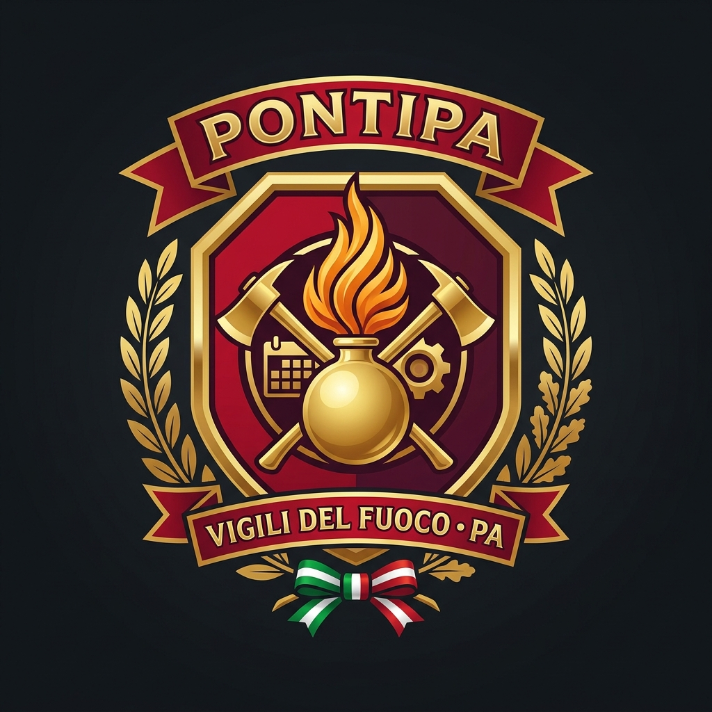

# PontiVVF • PA — Portale Pianificazione Oraria, Congedi, Straordinari e Buste Paga NoiPA

<p align="center">
  
</p>

**PontiVVF • PA** è il software gestionale interattivo progettato per il personale del **Corpo Nazionale dei Vigili del Fuoco** e della **Pubblica Amministrazione** (CCNL Comparto Funzioni Centrali, RTP e Ruoli Operativi/Direttivi) con contratto a **36 ore settimanali** su 5 giorni lavorativi.

L'interfaccia grafica ad **alta leggibilità** è ispirata al portale istituzionale **vigilfuoco.it** (Rosso Cremisi VVF `#8f141b`, Oro Fiamma `#f59e0b`, font `Titillium Web` maggiorato e logo araldico con la Fiamma dei Vigili del Fuoco).

---

## 🎯 Obiettivi Strategici Configurabili & Clausola Minimi Accessi

Il motore matematico supporta due configurazioni orarie (`3 giorni da 6h + 2 rientri da 9h` oppure `5 giorni da 7h e 12m`) e permette di scegliere tra **due obiettivi strategici**:

1. **🌴 Obiettivo "Lavorare il Meno Possibile" (`min_work`)**:
   - Massimizza i ponti festivi (ROI fino a **4.0x**) e riduce al minimo assoluto le ore lavorate nell'anno.
2. **🪙 Obiettivo "Guadagnare il Più Possibile con gli Straordinari" (`max_overtime`)**:
   - Sfrutta l'**arbitraggio tra giornate da 9h e giornate da 6h**: usa le ferie sui rientri lunghi da 9h (dove le 3 ore pomeridiane sono ordinarie) e preserva in servizio i turni brevi da 6h per massimizzare le ore di **straordinario retribuito** (fino a 180h+ annue) e i **Buoni Pasto**.
3. **🚗 Clausola Opzionale "Venire al lavoro meno volte possibile" (`minimizeCommute`)**:
   - Impone di allocare le **36 ore di permessi** (18h personali + 18h visite mediche) esclusivamente sui turni brevi da 6h, ottenendo **6 intere giornate a casa** invece di 4 (**-36 viaggi A/R casa-sede** e solo ~217 presenze annue su 365).

---

## 💶 Gestione Economica & Simulatore Buste Paga NoiPA

Il modulo **Buste Paga & Stipendio NoiPA** calcola in tempo reale le **12 mensilità + la 13ª mensilità (Tredicesima)** in base a:
- **16 Figure Professionali / Qualifiche**:
  - *Ruolo Operativo VVF* (Allievo, Vigile, Vigile Esperto, Vigile Coordinatore);
  - *Ruolo Capi Squadra e Capi Reparto* (CS, CSE, CR, CRE);
  - *Ruolo Ispettori e Direttivi Antincendi* (Vice Ispettore, Ispettore, Ispettore Antincendi Esperto, Vice Direttore, Direttore VVF);
  - *Ruolo Tecnico-Professionale (RTP) / PA* (Operatore, Assistente, Ispettore RTP, Funzionario RTP).
- **7 Scaglioni di Anzianità di Servizio** (da `0–4 anni` a `28+ anni`), con ricalcolo automatico dello scatto tabellare, dell'assegno di specificità e della tariffa oraria dello straordinario.
- **3 Fasce di Maggiorazione Straordinario CCNL**: Feriale Diurno (`+15%`), Festivo o Notturno (`+30%`), Notturno Festivo (`+50%`).
- **Calcolo Fiscale e Previdenziale**: Contributi INPS ex-INPDAP (`9,15%`), scaglioni IRPEF progressivi (`23%`, `35%`, `43%`), detrazioni lavoro dipendente ex art. 13 TUIR, addizionali regionali/comunali e **Buoni Pasto elettronici esentasse**.

---

## 📊 Esportazioni Ufficiali
- **Microsoft Excel (`.xlsx` a 4 fogli)**:
  1. *Foglio Presenze Annuale*
  2. *Registro Ponti Festivi*
  3. *Riepilogo Quadro Presenze*
  4. *Prospetto Buste Paga NoiPA (12 Mesi + 13ª Mensilità)*
- **iCalendar (`.ics`)**: compatibile con Google Calendar, Apple Calendar e Microsoft Outlook.
- **Stampa Ufficiale / PDF**: layout ottimizzato `@media print`.

---

## 🚀 Avvio Rapido

```bash
npm install
npm run dev
```

Apri il browser all'indirizzo `http://localhost:5173`.
